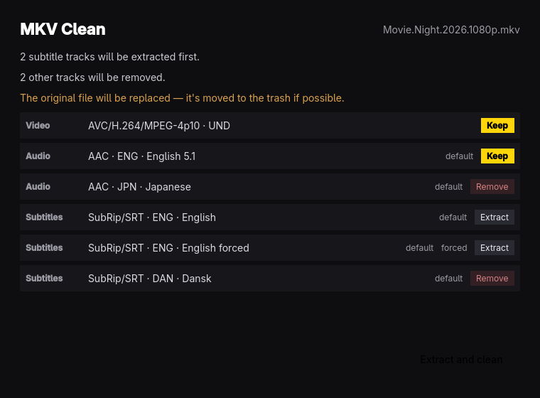

# MKV Clean

One job: pull the English subtitles out of an MKV, then remux it down to the
video plus the default English audio track — no subtitles, no other audio,
no leftover track names ("English [Original]" and friends are blanked, so
players show the language instead).
Powered by MKVToolNix (`mkvmerge`, `mkvextract`). English subtitles land next
to the file, tagged by kind — `Movie.en.srt` for the plain track,
`Movie.sdh.en.srt` for SDH/CC (only when there is no plain English subtitle),
`Movie.forced.en.srt` for forced (always) — and the cleaned
file **replaces the original in place**: the remux is verified first, then
the original is moved to the trash when the desktop offers one, so it stays
recoverable.

## Use it

Open files or a whole folder with the buttons, drop any mix of them onto the
window, or pass them on the command line. One file stops at the track plan —
what is kept, what is extracted, what is removed — for a Space to confirm.
Several files or a folder run as a batch: the queue shows each file's state,
a bad file is marked and skipped, and Cancel stops the batch early.

| Key   | Action                                  |
| ----- | --------------------------------------- |
| Space | Extract and clean / continue            |
| O     | Open files                              |
| F     | Open folder                             |
| Esc   | Cancel the running job                  |
| ?     | Keyboard shortcuts                      |
| Q     | Quit (asks while a job is running)      |

A file without an English audio track is refused with a clear message rather
than stripped of everything.

## From the command line

`mkvclean clean <file-or-folder>… [--json]` runs the whole job without a
display — including replacing the originals. Folders are scanned recursively
for MKVs. One file prints a single JSON summary; several print one JSON
object per line, each with `"status": "ok"` or `"error"`. Exit is 0 when
everything was cleaned, 1 if anything failed. `mkvclean skill install`
installs a short agent skill describing it.

## Build and install

    ./bin/build       # qmake6 + make into build/
    ./bin/test        # offscreen Qt Test suite
    ./bin/install     # makepkg -fsi: binary, launcher entry, icon

Follows the Omarchy theme and language live. Track planning and the
MKVToolNix processes are C++; the window is QML (Material, dark). The portal
file picker and theme watching are adapted from
[Omacut](https://github.com/omacom/omacut) (MIT, David Heinemeier Hansson).
