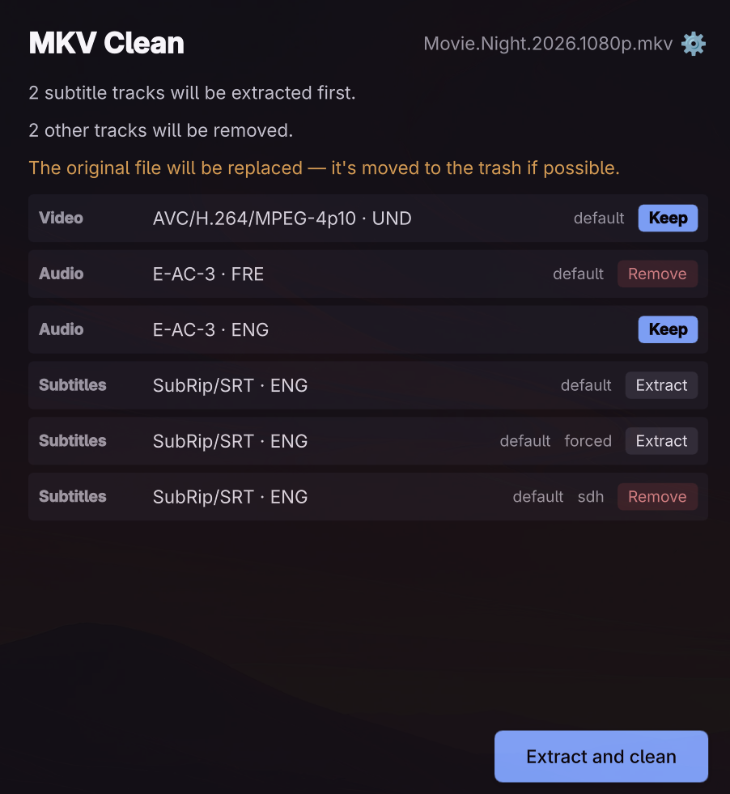
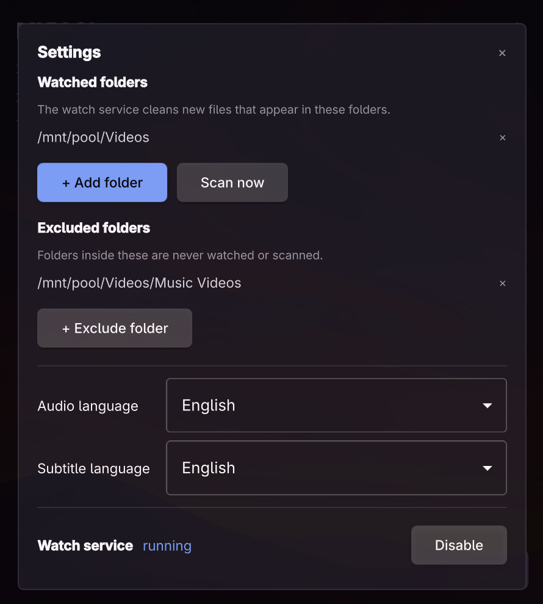

# MKV Clean

One job, done well: pull the subtitles you want out of an MKV, then remux it
down to the video plus a single audio track — replacing the original in
place. By hand, as a batch, or automatically as files arrive. Powered by
MKVToolNix (`mkvmerge`, `mkvextract`).

## Features

- **A track plan before anything happens**: every track is shown as Keep,
  Extract, or Remove; nothing is touched until you press Space. A foreign
  film is never refused and never gutted.
- **Subtitle extraction, tagged by kind**: `.en.srt` for the plain track,
  `.sdh.en.srt` for SDH/CC (by flag or by track name), `.forced.en.srt` for
  forced. SDH extracts only when there is no plain subtitle. Other languages
  get their own suffixes (`.da.srt`, `.de.srt`, …).
- **One audio track survives**: the default track in your preferred
  language, else the first in that language, else the default foreign
  track — a genuinely foreign film stays watchable; a file with no audio
  becomes video-only.
- **In-place replace, safely**: the remux is verified first, the original
  goes to the trash (recoverable), and the cleaned file takes its place.
  Leftover track names ("English [Original]") are blanked so players show
  the language instead.
- **Emby-proof**: if the original is busy (a scan, credit detection, a
  player), the verified remux is left behind as `Movie.mkv.remux` and the
  watch service completes the swap automatically on a later pass.
- **Batch**: drop files and folders, multi-select in the picker, or point
  the CLI at a folder — the queue shows each file's state, and one bad file
  never stops the batch.
- **Watch service**: a systemd user service cleans new arrivals in your
  watched folders once they finish copying, with excluded folders (a Music
  Videos folder, say) and a manual **Scan now** for anything missed.
- **Settings panel** (`S`): watched folders, excluded folders, preferred
  audio and subtitle languages (~50 languages), and the service toggle.
  Shared by the GUI, the CLI, and the service.
- **Headless CLI + agent skill**: `mkvclean clean` and `mkvclean watch …`
  with JSON output for scripts; `mkvclean skill install` teaches your agent.
- **Omarchy-native**: follows the theme accent and window rounding live, and
  the language live — English, Danish, German, French, and Brazilian
  Portuguese included.

## Use it

Open files or a whole folder with the buttons, drop any mix of them onto the
window, or pass them on the command line. One file stops at the track plan —
what is kept, what is extracted, what is removed — for a Space to confirm.
Several files or a folder run as a batch: the queue shows each file's state,
a bad file is marked and skipped, and Cancel stops the batch early.

| Key   | Action                                  |
| ----- | --------------------------------------- |
| Space | Extract and clean / continue            |
| O     | Open files                              |
| F     | Open folder                             |
| S     | Settings                                |
| Esc   | Cancel the running job                  |
| ?     | Keyboard shortcuts                      |
| Q     | Quit (asks while a job is running)      |

## From the command line

`mkvclean clean <file-or-folder>… [--json]` runs the whole job without a
display — including replacing the originals. Folders are scanned recursively
for MKVs. One file prints a single JSON summary; several print one JSON
object per line, each with `"status": "ok"` or `"error"`. Exit is 0 when
everything was cleaned, 1 if anything failed. `mkvclean skill install`
installs a short agent skill describing it.

## Watch service

`mkvclean watch` runs a headless watcher: any MKV that appears in a
configured folder gets the full treatment as soon as the file has finished
copying (size and mtime settled). Files already in the folder when the
watcher starts are never touched; a failure (unreadable, or nothing to do)
is logged and skipped, and the batch moves on. When a replacement was
blocked earlier — Emby holding the original open, say — the leftover
`.remux` file is swapped into place on the next pass.

    mkvclean watch add "/mnt/pool/Videos"            # define folders
    mkvclean watch exclude "/mnt/pool/Videos/Music Videos"
    mkvclean watch list
    mkvclean watch remove <folder>                   # …or unexclude <folder>
    mkvclean watch scan [--json]                     # clean everything missed so far
    mkvclean watch enable      # systemd --user enable --now mkvclean
    mkvclean watch status
    mkvclean watch disable

The package ships a systemd user unit, so `watch enable` starts the service
now and at every login. Logs: `journalctl --user -u mkvclean -f`. Preferences
(watched folders, exclusions, languages) live in
`~/.config/mkvclean/config.json`.

## Build and install

    ./bin/build       # qmake6 + make into build/
    ./bin/test        # offscreen Qt Test suite
    ./bin/install     # makepkg -fsi: binary, launcher entry, icon

Track planning and the MKVToolNix processes are C++; the window is QML
(Material, dark). The portal file picker and theme watching are adapted from
[Omacut](https://github.com/omacom/omacut) (MIT, David Heinemeier Hansson).
